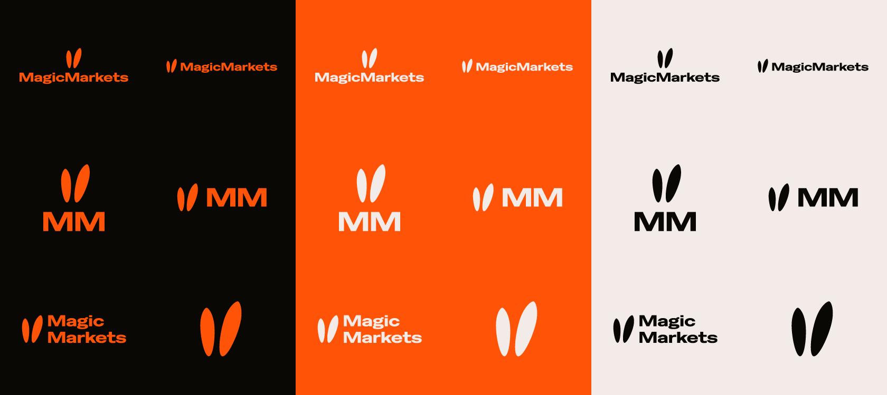
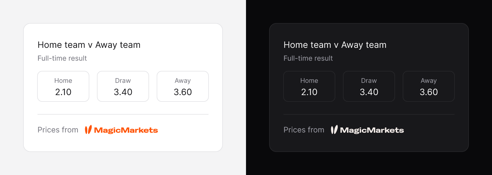

# MagicMarkets brand kit

Official MagicMarkets logos and colours for partners, press and anyone who shows MagicMarkets prices.



## Download

- **All files:** [MagicMarkets_Brand.zip](https://github.com/magicmarkets/brand/releases/latest/download/MagicMarkets_Brand.zip). The zip holds every logo, the colour files and this guide.
- **One file:** open the [`logos`](logos) or [`colours`](colours) folder and download the file you need.

## Which logo to use

| Folder | Mark | Use it for |
| --- | --- | --- |
| [`01_Primary`](logos/01_Primary) | Ears above MagicMarkets | The default mark. Press articles, hero placements and partner pages. |
| [`02_Secondary-Horizontal`](logos/02_Secondary-Horizontal) | Ears + MagicMarkets | Headers, banners and source lines, for example "Prices from MagicMarkets". Use this one when there is room in a row. |
| [`03_Monogram-Vertical`](logos/03_Monogram-Vertical) | Ears above MM | Compact square spaces, such as a partner logo grid. |
| [`04_Monogram-Horizontal`](logos/04_Monogram-Horizontal) | Ears + MM | Small horizontal spaces where the full name does not fit. |
| [`05_Stacked-Restricted`](logos/05_Stacked-Restricted) | Ears beside Magic / Markets | **Restricted.** Use it only when no other mark fits the space. |
| [`06_Ears-Symbol`](logos/06_Ears-Symbol) | The ears | Avatars, and a small source marker in a table cell or a list row. Never put it next to another MagicMarkets logo. |
| [`07_Square-Icon`](logos/07_Square-Icon) | The ears on a square | Lists or tables that show one square icon for each source, and favicons. |

## Show "Prices from MagicMarkets"



When you show MagicMarkets prices, put a source line next to them:

- Write "Prices from" in your own interface font and text colour, then show the secondary lockup.
- Show the lockup artwork at 16px tall or more. The file includes clear space, so set the file height to 34px or more.
- Use Carrot Orange on a light interface. Use Snow Bunny or Carrot Orange on a dark interface.
- Link the line to [magicmarkets.com](https://magicmarkets.com). If you have a MagicMarkets partner referral link, use that link.
- Host the logo file on your own site. Do not load it from this repo, because the file paths can change.

```html
<a class="mm-source" href="https://magicmarkets.com">
  <span>Prices from</span>
  
</a>
```

```css
.mm-source {
  display: inline-flex;
  align-items: center;
  color: inherit;
  text-decoration: none;
}
.mm-source img {
  display: block;
  height: 34px;
  width: auto;
}
```

The clear space inside the SVG gives the gap between the text and the logo. Do not add more space, and do not crop the file.

## Logo colours

The logo is always one solid colour. Pick the file whose colour stays legible on your background.

| File suffix | Colour | Use on |
| --- | --- | --- |
| `CarrotOrange` | `#FF5408` | Easter Brown, Snow Bunny, white, or a dark background |
| `SnowBunny` | `#F2EBE8` | Easter Brown, Carrot Orange, or a dark background |
| `EasterBrown` | `#0A0805` | Snow Bunny, Carrot Orange, white, or a light tint |

Do not put a logo on a background of the same colour. Do not use Easter Brown on a dark background.

The square icons come in two fixed pairs: Carrot Orange on Easter Brown, and Snow Bunny on Carrot Orange.

## Brand colours

The [`colours`](colours) folder holds the full palette:

- `MagicMarkets_Colours.css`: CSS custom properties, for example `--mm-carrot-orange`.
- `MagicMarkets_Colours.json`: every colour with HEX, RGB, CMYK and its use.
- `MagicMarkets_Colours.ase`: Adobe swatches for Illustrator, Photoshop and InDesign.

| Name | HEX | RGB | CMYK | Use |
| --- | --- | --- | --- | --- |
| Carrot Orange | `#FF5408` | 255, 84, 8 | 0, 81, 100, 0 | The signature accent |
| Snow Bunny | `#F2EBE8` | 242, 235, 232 | 4, 6, 6, 0 | The light ground |
| Easter Brown | `#0A0805` | 10, 8, 5 | 72, 67, 67, 86 | The dark ground |

The files also hold seven warm tints, a chart palette and the market direction colours. Use green and red only to show market direction (price up and price down).

## Formats

- **SVG:** vector. This is the best format for websites and apps.
- **PDF:** vector. Use it for print and for design tools that do not open SVG.
- **PNG:** transparent background. The file without a size suffix is 1000px wide. The `_4000px` file is 4000px wide, for print and large screens.
- **Square icons:** opaque PNG at 32, 64, 128, 256, 512 and 1024px, plus an `.ico` favicon that holds 16, 32, 48 and 64px.

## Clear space

Clear space is built into each file. It is equal to X, the height of the wordmark, on all four sides. If you crop a file, keep a space of X on all sides. Do not put text, graphics or edges inside that space.

## Typography

MagicMarkets sets headlines in Feature Deck Condensed, a commercial typeface from [Commercial Type](https://commercialtype.com). Body text, labels and numbers use [Inter](https://fonts.google.com/specimen/Inter), which is free. You do not need either font to show the logo or a source line.

## Rules

- Use the files as supplied. Do not redraw, retype or trace the logo.
- Do not stretch, squash, skew or rotate the logo.
- Do not rearrange the parts of a mark, and do not move, swap or remove the ears.
- Do not change the colours. Use only the colourways in this kit.
- Do not add effects: no outlines, shadows, glows or gradients.
- Do not use the logo as a watermark, tiled or faded.
- Put the logo only on a background with enough contrast. On a photo, put it where the image is quiet.
- The name is always **MagicMarkets**: one word, with a capital M twice.

## Trademarks

MagicMarkets and the MagicMarkets logos are trademarks of MagicMarkets. Read [TRADEMARKS.md](TRADEMARKS.md) before you use them.

## Questions

Email [support@magicmarkets.com](mailto:support@magicmarkets.com) with questions about the logos, or to ask for a format that is not here.

[magicmarkets.com](https://magicmarkets.com)
